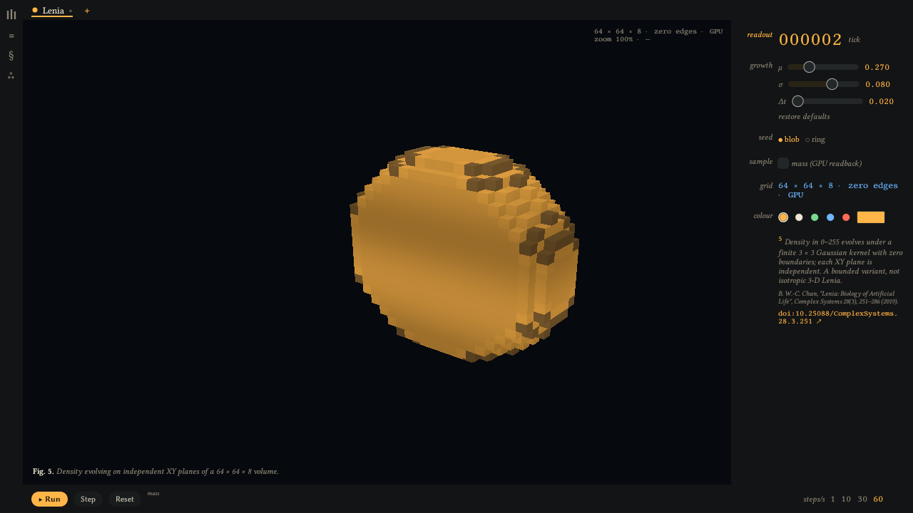
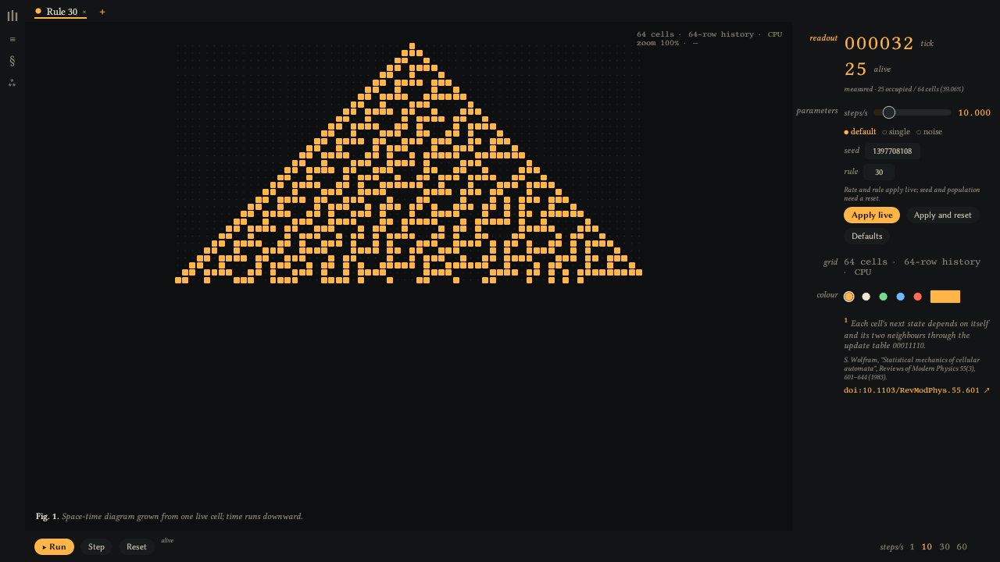
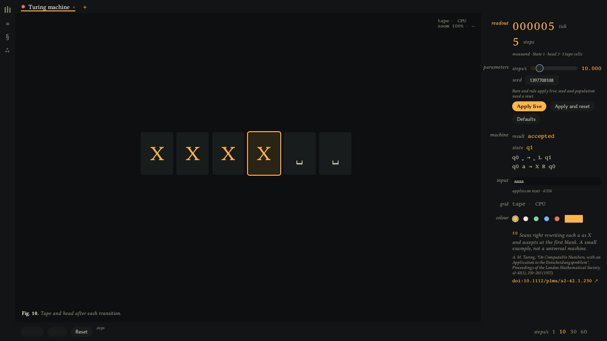
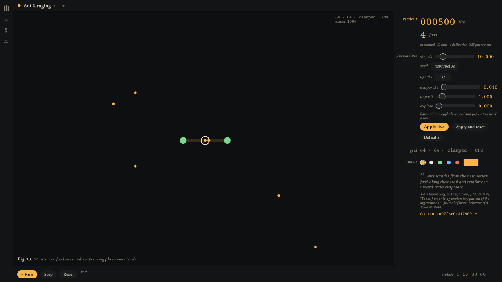
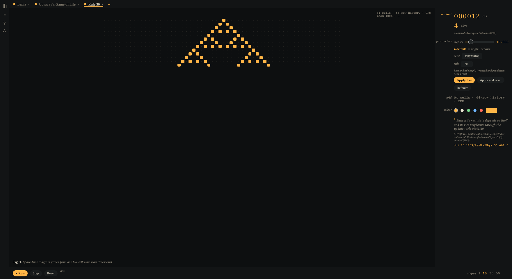

# S.O.U.L. — Swarm Orchestrator for Autonomous Learners

**An automata laboratory built on Bevy.** Cellular automata, formal-language
machines, rewriting systems, agent swarms and GPU Lenia run side by side as
independent *channels* in one workbench. You can step, measure, compare, save
and present them, and every specimen cites its source.



| Rule 30 | Turing machine | Ant foraging |
| --- | --- | --- |
|  |  |  |

## Contents

- [Highlights](#highlights)
- [Quick start](#quick-start)
- [Using the lab](#using-the-lab)
- [Specimen catalog](#specimen-catalog)
- [Architecture](#architecture)
- [Verification](#verification)
- [Development](#development)
- [Roadmap](#roadmap)
- [License](#license)

## Highlights

- **One lab, many models.** Up to eight channels, CPU and GPU together, each
  with its own state, clock, rate (1–60 steps/s) and colour.
- **Instrument-grade presentation.** A full-bleed stage, a margin inspector,
  status-lamp tabs, a transport with a live metric trace, and a presenter mode
  for live demonstrations.
- **Experiments, not just animations.** Live rule and parameter edits, a
  side-by-side comparison with synchronised stepping, PNG/GIF/project exports,
  and project save and restore that includes completed GPU state.
- **Honest science.** Captions state each model's bounds, and every specimen
  links to its primary source by DOI. Variants are labelled as variants.
- **Qualified on real and software GPUs.** Scripted native runs check every
  family on an NVIDIA RTX 3090 and on Mesa lavapipe. GPU Lenia is checked
  against a CPU reference.

## Quick start

**Requirements:** stable Rust (CI pins 1.94.1), Python 3.11 or newer, a Vulkan
driver on Linux (macOS uses Metal), and Bevy's native build dependencies (on Debian/Ubuntu:
`libasound2-dev libudev-dev libwayland-dev libxkbcommon-dev cmake ninja-build`).

```sh
cargo run            # main menu → scenarios → lab
make automata        # straight into the lab with Rule 30 at tick 32
make lenia           # straight into the lab with GPU Lenia, paused
make experiment      # Lenia, Life and Rule 30 with comparison and projects
make preview         # static 16³ voxel rendering fixture
```

Windows request (80, 80) on the first monitor: 1280 × 720 normally and
1760 × 960 for scripted lab previews. The Make targets
force X11/Xwayland so the compositor honours that placement. To use software
Vulkan, prefix a target with
`VK_DRIVER_FILES=/usr/share/vulkan/icd.d/lvp_icd.json`.

## Using the lab



| Region | What it does |
| --- | --- |
| **Rail** | The library, compare (≡) and project (§) drawers, and settings (⁂): presenter mode and the GPU debug marker. |
| **Library** | Built-in specimens, named saved CPU/GPU states, validated import/export and duplication, plus three guided paired experiments. Opening a saved specimen or scenario replaces the current channels. |
| **Tabs** | One per channel, with a status lamp: green running, amber paused, red halted. Close with ×, add with +. |
| **Stage** | The selected channel with a figure caption and an arena/zoom/cursor readout. On CPU stages, scroll to zoom, drag to pan and double-click to reset; GPU Lenia renders through the 3-D camera. |
| **Inspector** | Tick and headline metric, experiment parameters (*Apply live*, *Apply and reset*, *Defaults*), machine state and transition table, symbolic input, arena, channel colour, and a cited footnote with a DOI link. Drag it between 220 and 420 px, or collapse it. |
| **Transport** | Run/Pause, Step, Reset, the metric trace, and the 1 / 10 / 30 / 60 steps/s presets. |

| Key | Action |
| --- | --- |
| <kbd>Space</kbd> | Run or pause the selected channel (handed to the free camera while it is active) |
| <kbd>.</kbd> | Step once while paused |
| <kbd>R</kbd> | Reset |
| <kbd>1</kbd>–<kbd>8</kbd> | Select a tab |
| <kbd>P</kbd> | Presenter mode: full-window stage, HUD readouts, fading transport |
| <kbd>N</kbd> | Show or hide the inspector |
| <kbd>L</kbd> | Library |
| <kbd>Esc</kbd> | Close the popover or drawer, or leave presenter mode; otherwise open the pause menu |

The arrow keys, WASD and Z/X stay with the camera. Shortcuts are suspended
while a text field has focus.

**Measurements.** Each family publishes a headline metric (population, live
cells, particles, steps, length, order or food) into a 200-sample trace.
Lenia's mass comes from GPU readbacks, so it is opt-in (inspector → *sample*).
It is sampled at 4 Hz and yields to project saves.

**World authoring.** Cellular channels support dimensions from 8 to 256 and dead
or periodic boundaries. Pause to paint or erase on the stage; undo/redo groups
whole strokes. Edited fields become Reset seeds and survive project save/load.

**Comparison and projects.** The Compare drawer selects CPU or GPU channels and
waits for completed states when stepping. Compatible fields show error statistics
and difference heatmaps; metric traces and CSV exports retain epochs, ticks and
units. PNG/GIF/project exports evolve isolated copies. The Project drawer saves
paused channels, including exact completed GPU state. Loading replaces every
channel. See the [worlds and comparison guide](docs/verification/worlds/README.md).

**Reusable specimens and guides.** In the Library, name and save the selected
channel to preserve its exact paused state, duplicate it, or import/export a
validated JSON specimen. Files live in the platform data directory under
`soul/specimens` (`SOUL_LIBRARY` overrides it). Existing names are never overwritten.
The scenario launcher offers Rule 30/110, dead/periodic Life and accepted/rejected
pushdown inputs, with prediction, stepping, comparison and export cues that stay
available in presenter mode.

## Specimen catalog

| Specimen | Group | What the lab shows | Source |
| --- | --- | --- | --- |
| Rule 30 | cellular | Elementary CA, 64 cells, 64-row history | [Wolfram 1983](https://doi.org/10.1103/RevModPhys.55.601) |
| Rule 110 | cellular | Elementary CA, the rule proven universal | [Cook 2004](https://doi.org/10.25088/ComplexSystems.15.1.1) |
| Conway's Game of Life | cellular | B3/S23 on a bounded 64 × 64 field | [Gardner 1970](https://doi.org/10.1038/scientificamerican1070-120) |
| HPP lattice gas | cellular | Four-direction particles with head-on scattering | [Hardy, Pomeau & de Pazzis 1973](https://doi.org/10.1063/1.1666248) |
| Lenia (GPU) | cellular | Quantized density on independent XY planes of a 64 × 64 × 8 volume | [Chan 2019](https://doi.org/10.25088/ComplexSystems.28.3.251) |
| Finite automaton | machines | NFA for `a*b`, tracking every reachable state | [Rabin & Scott 1959](https://doi.org/10.1147/rd.32.0114) |
| Pushdown automaton | machines | aⁿbⁿ with its stack | [Chomsky 1956](https://doi.org/10.1109/TIT.1956.1056813) |
| Balanced parentheses | machines | Pushdown recogniser | [Chomsky 1956](https://doi.org/10.1109/TIT.1956.1056813) |
| Linear-bounded automaton | machines | aⁿbⁿcⁿ within the input tape | [Kuroda 1964](https://doi.org/10.1016/S0019-9958(64)90120-2) |
| Turing machine | machines | Rewrites each `a` as `X` and halts at the first blank | [Turing 1937](https://doi.org/10.1112/plms/s2-42.1.230) |
| Koch curve | grammars | L-system `F → F+F--F+F`, bounded at 4096 symbols | [Lindenmayer 1968](https://doi.org/10.1016/0022-5193(68)90079-9) |
| Boids | agents | 24 flocking agents in a wrapping arena | [Reynolds 1987](https://doi.org/10.1145/37402.37406) |
| Ant foraging | agents | 32 ants, two food sites, evaporating pheromone | [Deneubourg et al. 1990](https://doi.org/10.1007/BF01417909) |

**Scope notes.**

- *Lenia.* The default quantized model stores density in 0–255, with independent
  XY planes, a finite 3 × 3 kernel and zero edges. The inspector also offers
  continuous XYZ: float density, normalized Gaussian/shell kernels, configurable
  radius, dead/periodic boundaries and coupling across all axes. Model changes
  reset the field. The separate **Published Orbium** library entry restores Chan's
  original 20 × 20 seed and polynomial periodic XY model (radius 13), qualified
  against an independent FFT reference. See its [provenance](assets/specimens/README.md).
- *Machines.* Tapes and stacks use 3-D voxel entities with a white head marker
  and a symbol colour key in the inspector. The linear-bounded automaton never grows its tape. The Turing
  machine is a small transition table, not a universal machine.

Editing a specimen's rule, seed pattern or population retitles its channel
(for example, *Rule 90 · space-time*) and marks the catalog text as describing
the original. Specimen copy lives in
[`assets/specimens/specimens.toml`](assets/specimens/specimens.toml). The
family contracts are in [`docs/kanban/automata-families.md`](docs/kanban/automata-families.md).

## Architecture

The lab is built around one **channel contract**
(`engine_core::automata::channel`). Backends own simulation state and publish
read-only rows; the UI reads those rows and writes commands. Neither side
reaches into the other.

```
 ui::lab ──ChannelCommand / AutomataCommand / ConfigureSession──▶ backends
    ▲                                                          │
    └──────────── Channels · Metrics (read-only snapshots) ◀────┘
                     CPU: models::workbench   GPU: engine-render + engine-gpu
```

- **Ids and capacity.** `ChannelIds` hands out ids that are never reused, and
  caps open channels at eight across both backends.
- **Ordering.** `ChannelSet::{Route, Tick, Publish, Settle}` runs after input,
  so a command lands, the channel steps, its row publishes and the selection
  is repaired in the same frame.
- **Pacing.** `StepClock` paces each channel on its own. Colours become
  four-stop Oklab ramps, which the voxel shader looks up per instance.

| Crate / root | Responsibility |
| --- | --- |
| `src/app` | Runtime configuration, plugin registration, scripted previews and qualification |
| `lib/simulation_kernel` | Rule interfaces, cell storage, CPU steppers, Lenia reference |
| `lib/engine/engine-core` | Channel contract, registries, events, application state |
| `lib/engine/engine-common` | Scene flow, cameras, stage viewport and input gating |
| `lib/engine/engine-gpu` | GPU storage, surface extraction, compute and indirect draw |
| `lib/engine/engine-render` | Automaton commands, GPU channel routing, readback sampling |
| `lib/models` | Automaton families, workbench sessions, experiments, projects, specimens |
| `lib/ui` | Instrument theme (tokens, Libertinus type, widgets), the lab shell, meta menus |
| `lib/tooling` | Debugging, logging and monitoring |
| `lib/tests` | Cross-crate native behaviour tests |
| `tools/structure` | Structural-governance checker and its self-tests |

The portable renderer extracts exposed voxel faces on the GPU and draws them
indirectly. The optional `engine-gpu/mesh_shaders` feature keeps an
experimental ash/Vulkan mesh-shader path for development. That path is not in
the portable render graph and has not qualified for runtime use.

## Verification

```sh
make check              # governance + rustfmt + strict Clippy + native and GPU tests
make verify-automata    # all 12 CPU families, screenshots and image checks
make verify-lenia       # GPU Lenia against the CPU reference, lifecycle and channels
make verify-experiment  # parameters, comparison, project round-trip, export
make verify-authoring   # saved specimens, guided experiments, voxel machines, Orbium
make verify-boot        # native window, rendered screenshot and clean exit
make benchmark-steppers # 27 Criterion stepper cases
```

Each `verify-*` target writes evidence to `/tmp/soul-*-verification`. Override
the path with `SOUL_AUTOMATA_VERIFY`, `SOUL_LENIA_VERIFY` or
`SOUL_EXPERIMENT_VERIFY`, `SOUL_AUTHORING_VERIFY` or `SOUL_BOOT_VERIFY`. The harness refuses a directory that already holds a
success marker. The runs drive the production command path, including a
`ChannelCommand` pass for every family. Every screenshot must show specimen
pixels inside the published stage rectangle with no panel overlapping it.

| Evidence | RTX 3090 (NVIDIA 550, Vulkan) and Mesa lavapipe |
| --- | --- |
| Automata families | [Record](docs/verification/automata/README.md) |
| GPU Lenia | [Record](docs/verification/lenia/README.md) |
| Experiments | [Record](docs/verification/experiments/README.md) |
| Authoring, guides, voxel machines and published Orbium | [Record](docs/verification/authoring/README.md) |
| Static voxel baseline | [Before](docs/verification/voxel-before.png) / [after](docs/verification/voxel-after.png) |

The GPU tests need a Vulkan adapter; CI installs Mesa for software execution.
They exercise production buffers, pipelines and bindings, and compare Lenia
densities and surface counts with CPU references.

## Development

```sh
python3 -m pip install -r tools/structure/requirements.txt
make check
```

`make check` runs on every push and pull request
([workflow](.github/workflows/check.yml)). A passing local check does not imply
a hosted run.

**Structural governance.** [`structural-governance.toml`](structural-governance.toml)
declares every source root: Rust, WGSL, Python, PowerShell and the checker
itself. In every governed directory:

- at most three child directories;
- one to four source files;
- no file above 200 non-comment source lines.

There are no exceptions. The checker also reports source files outside the
declared roots.

**Conventions.**

- Use `snake_case` modules, `PascalCase` types and `SCREAMING_SNAKE_CASE`
  constants.
- Bevy plugins own registration. Systems communicate through resources,
  components and events, with explicit schedule ordering.
- Keep simulation separate from presentation.
- Document public items, and explain invariants and synchronisation in
  comments.
- When moving code, keep public paths stable with re-exports.

**Contributing.**

- Pick a card from [`docs/kanban/v0-0-2.md`](docs/kanban/v0-0-2.md) and keep
  its status current.
- Commit at least every 100 changed source lines.
- Attach before/after screenshots or GIFs for rendering changes.
- Keep structural and behavioural changes reviewable.

Design specs and implementation plans live in [`docs/superpowers`](docs/superpowers).

## Roadmap

The lab shell, editable worlds, comparison/export, named specimen library,
three guided experiments, voxel machine views, published Orbium and stepper
benchmarks are implemented. Cross-platform build and boot qualification is
tracked in the [authoring evidence](docs/verification/authoring/README.md).

Remaining product work:

1. **General rule authoring.** Define and validate new rules beyond the existing
   family parameter editors; persist and share those definitions.
2. **Layer compositing.** Specify and implement how two rule layers interact.
3. **Dean's multi-energy rule.** Agree birth, survival, energy transfer and decay
   semantics before implementing and qualifying it.
4. **2-D sprite renderer decision.** The older roadmap still lists a sprite view;
   decide whether it is useful alongside the requested voxel presentation.

The experimental ash mesh-shader renderer remains a separate, unqualified path.
See the current [kanban](docs/kanban/v0-0-2.md); the larger
[GPU-engine reference roadmap](docs/references/gpu-rendering_roadmap.md) describes
longer-term rendering ambitions beyond this workbench milestone.

## License

S.O.U.L. is distributed under the [Elastic License 2.0](LICENSE.md). The
bundled Libertinus fonts are © the Libertinus authors under the
[SIL Open Font License 1.1](assets/fonts/libertinus/OFL.txt). The original
Orbium seed is © Bert Chan under its bundled [MIT license](assets/specimens/LICENSE-Lenia.txt).
