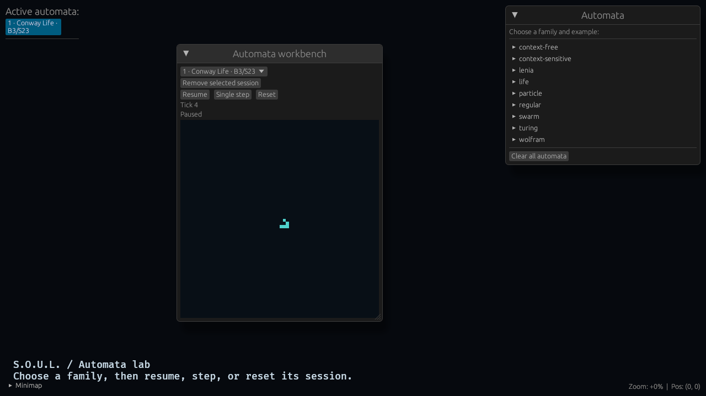
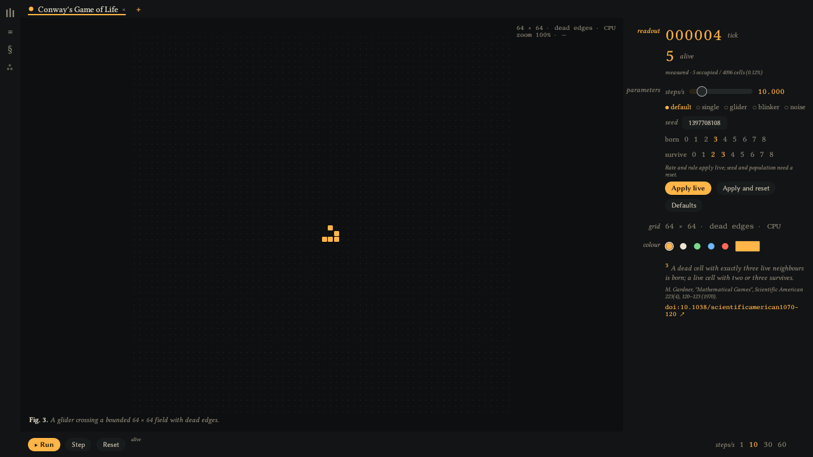

# S.O.U.L. — Swarm Orchestrator for Autonomous Learners

A Bevy workbench for cellular automata and volumetric simulation experiments.
The current renderer uses portable GPU surface extraction and indirect drawing.
Quantized Lenia evolution is verified on NVIDIA and Mesa Vulkan. The optional
ash/Vulkan mesh-shader backend remains experimental.

## Run

Use the stable Rust toolchain, Python 3.11+, and native Bevy build dependencies.

```sh
cargo run
```

Start the verified Lenia workbench, paused with a deterministic blob:

```sh
make lenia
```

The window opens on monitor 1 at (80, 80), sized 1280 × 720, in the lab
described below. Lenia's inspector holds growth sliders (μ, σ, Δt), restore
defaults, Blob/Ring seeds and opt-in GPU mass sampling.

This variant stores density in 0..255 and evolves independent XY planes using a
finite 3×3 Gaussian kernel with zero boundaries. GPU buffers swap every tick;
the final density feeds voxel extraction and shading. The bounded ring fixture
is not a qualified published Orbium organism or isotropic 3-D Lenia.

Run the automated native workbench qualification and save screenshots/readbacks:

```sh
make verify-lenia
# Force software Vulkan on this Linux workstation:
VK_DRIVER_FILES=/usr/share/vulkan/icd.d/lvp_icd.json make verify-lenia
```

Set `SOUL_LENIA_VERIFY` to change the default `/tmp/soul-lenia-verification`
output directory. Qualification exits after spawn, step, pause, parameter edit,
reset, seed change, resume, clear, and respawn have matched the CPU reference.
See the [Lenia evidence](docs/verification/lenia/README.md) for captured results.

Open the complete family catalog with a populated Rule 30 history:

```sh
make automata
make verify-automata
```

The catalog provides isolated CPU sessions for Rule 30/110, Conway Life, HPP,
finite/stack/bounded-tape/Turing machines, Koch rewriting, boids and ants, plus
GPU Lenia. The LBA never grows its input tape, and the Turing example is a small
transition table, not a universal machine. See the
[family contracts](docs/kanban/automata-families.md) and
[qualification evidence](docs/verification/automata/README.md).

## Lab

Every specimen runs as a *channel* in one automata lab:

- **Rail** (left, 32 px): the library, compare (≡) and project (§) drawers, and
  settings (⁂) with presenter mode and the GPU debug marker.
- **Library drawer**: specimens grouped as cellular, machines, grammars and
  agents, with a filter. Click one to open it as a channel; up to eight channels
  (CPU and GPU together) can be open.
- **Channel tabs**: serif specimen names with status lamps (green running, amber
  paused, red halted), close (×) and add (+).
- **Stage**: the selected channel, painted in its colour, with a figure caption
  and an arena/zoom/cursor readout. CPU stages zoom with the wheel, pan by
  dragging and reset on double-click; GPU Lenia renders through the 3-D camera.
- **Inspector** (right, 220–420 px, drag to resize): tick and headline metric,
  experiment parameters (Apply live, Apply and reset, Defaults), machine state,
  symbolic input, arena, channel colour (swatches or any sRGB), and a footnote
  citing the specimen's source with a DOI link.
- **Transport** (bottom): Run/Pause, Step, Reset, the metric trace, and
  1/10/30/60 steps/s.

| Key | Action |
| --- | --- |
| Space | Run or pause the selected channel (left to the free camera when it is on) |
| `.` | Step once while paused |
| R | Reset |
| 1–8 | Select a tab |
| P | Presenter mode: full-window stage, HUD readouts and a fading transport |
| N | Collapse or show the inspector |
| L | Library |
| Esc | Close the drawer or leave presenter; otherwise open the pause menu |

Arrow keys, WASD and Z/X stay with the camera. Lenia mass is sampled from GPU
readbacks only after you opt in (inspector, *sample*), at 4 Hz, and pauses while
a project save holds the readback mailbox.

| Before | After |
| --- | --- |
|  |  |

The normal application starts at the main menu. To inspect a deterministic
16 × 16 × 16 voxel volume without navigating the scenario menus:

```sh
make preview
```

The preview is a static rendering fixture. It opens a resizable 1280 × 720 window
at desktop position (80, 80), leaving the second display available. The Make
target uses X11/Xwayland so the compositor honors this placement. It exercises
atlas offsets, exposed-face extraction, world transforms, depth testing, and the
indirect draw path. It does not demonstrate automaton evolution.

To save an image of only the application window after the renderer records its
first ready voxel draw:

```sh
SOUL_SCREENSHOT=/tmp/soul-preview.png make preview
```

The portable backend is the default. The `engine-gpu/mesh_shaders` feature keeps
experimental Vulkan code available for development; it is not registered in the
portable render graph and has not qualified for runtime use.

## Source ownership

| Source root | Responsibility |
| --- | --- |
| `src/app` | Runtime configuration, plugin registration, scheduling, preview |
| `lib/simulation_kernel/src` | Rule interfaces, cell storage, CPU steppers |
| `lib/engine/engine-core/src` | Registries, world metadata, application state |
| `lib/engine/engine-common/src` | Scene flow, camera input and motion |
| `lib/engine/engine-gpu/src` | GPU storage, extraction, compute and draw stages |
| `lib/engine/engine-render/src` | Render orchestration and automaton commands |
| `lib/models/src` | Automaton families, rule registration, analytics |
| `lib/ui/src` | Menus, styling, panels and overlays |
| `lib/tooling/src` | Debugging, logging and monitoring |
| `lib/tests/src` | Cross-crate native behavior tests |
| `tools/structure` | Structural enforcement and its self-tests |

Modules have one responsibility and expose deliberate façades. Bevy plugins own
registration; systems communicate through resources, components and events.
Keep simulation logic separate from presentation and make schedule ordering
explicit where one system depends on another.

## Structural governance

`structural-governance.toml` defines every governed source root, including
Rust tests, WGSL shaders, PowerShell scripts, Python tooling and the checker.
Every governed directory must contain:

- Zero to three direct governed child directories.
- One to four direct source files, including `mod.rs` and export façades.
- No source file above 200 non-comment source lines.

Language-aware tokenization excludes blanks and comment-only lines. Code with
trailing comments counts once; comment markers inside strings remain code.
There are no source-path exceptions. Binary assets, dependency/build output,
repository metadata and data-only files are outside the source boundary.
The checker also reports tracked or new source files outside the declared roots.

Use semantic `snake_case` filenames and modules, `PascalCase` Rust types, and
`SCREAMING_SNAKE_CASE` constants. Group related modules by ownership rather than
adding artificial nesting. Preserve public import paths with meaningful
re-exports when moving implementations. Document public types and functions;
explain invariants, synchronization and unsafe prerequisites in comments.

## Verify and contribute

```sh
python3 -m pip install -r tools/structure/requirements.txt
make check
```

`make check` runs the governance self-tests and complete audit, Rust formatting,
workspace Clippy with all targets/features and warnings denied, and native tests.
The GPU tests require a Vulkan adapter; CI installs Mesa for software execution.
They use production buffers, pipelines and bindings to compare Lenia densities
and surface counts with CPU references. Coverage includes tick parity, boundaries,
independent allocations, reset/removal/reuse, row packing, adjacency, transforms,
empty regions, low-density visibility and bounded overflow.

Pick a task from `docs/kanban/v0-0-2.md`, keep its status current, and include
before/after screenshots or GIFs for rendering changes. Keep structural and behavioral changes
reviewable and preserve unrelated working-tree changes. Commit at every 100
changed source lines (added plus removed nonblank, non-comment lines), or sooner.
CI runs `make check`; local passing checks do not imply a hosted CI run.

## Verified rendering baseline

GPU-003 verifies a static volumetric preview and structural compliance.
The [before image](docs/verification/voxel-before.png) records the initial blank
preview capture; the [after image](docs/verification/voxel-after.png) shows the
ready renderer. Capture waits for the first voxel draw instead of assuming
shader compilation has finished. Owned scene/UI cameras use one sample;
multisample pipeline specialization remains future work.

Structural extraction groups camera motion and translation, engine execution,
GPU rendering/storage/setup/drawing, formal grammars, individuality analytics,
UI presentation, and tooling telemetry. Existing consumer import paths are
re-exported where implementations moved.

On 2026-10-18, `CARGO_BUILD_JOBS=2 CMAKE_BUILD_PARALLEL_LEVEL=2 make check` passed
20 governance self-tests, 25 native tests, and 9 documentation tests, with zero
structural violations across 261 source files in all 14 roots (largest: 144 SLOC).
GPU checks and the complete Lenia workbench qualification passed on RTX 3090 and
Mesa software Vulkan. CI selects Python 3.13 and Rust 1.94.1 for consistency with
the verified local tools. See the [qualification record](docs/verification/lenia/README.md).

The 2026-10-19 family expansion passes 41 native tests, 9 documentation tests and
20 governance tests across 287 files in the same 14 roots; the largest source
file remains 144 SLOC. The [family evidence](docs/verification/automata/README.md)
records the current catalog and native qualification separately from GPU-003
and the earlier Lenia milestone.
